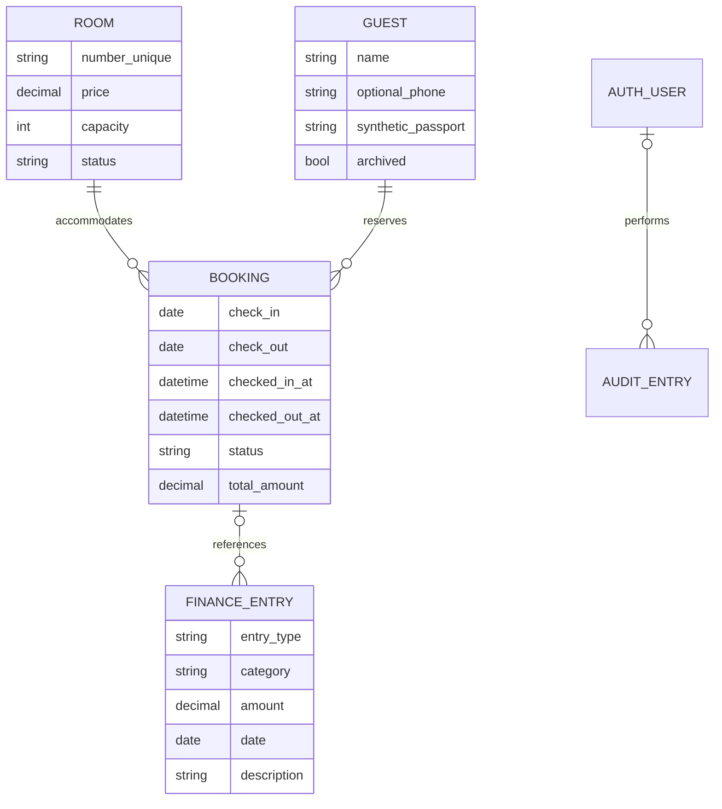

# 20 ish kunlik PDF bo‘yicha talablar xaritasi

Manba: foydalanuvchi bergan `Hotel_Demo_Amaliyotchilar_20_Kunlik_Reja.pdf`, 5 sahifa. Bu amaliyotchilar rejasi, o‘zi alohida TZ emas. Undagi dastur funksiyalari, texnologiya talablari va jamoaviy tashkiliy topshiriqlar alohida tekshirildi. Quyida hech bir bo‘lim tashlab ketilmagan; haqiqiy ishlash muhiti ham ochiq yozilgan.

## Ishlash muhitlari

**React sayti:** mavjud dizayn/route’lar saqlandi. Django serveridagi `/` va `/app/...` aynan shu React interfeysi orqali server sessiyasi va SQLite bilan ishlaydi. `hotelServer`, AppDataContext va AuthContext `/hotel-api`ga ulangan. Faqat mustaqil Vite/static rejimi backend belgisisiz eski localStorage demosidir. Haqiqiy Vercel deploy uchun backend hosting/proxy domeni alohida kerak.

**Django server demo:** `backend/` ichida Python, Django, SQLite, HTML/CSS, lokal Bootstrap. `/management/` server bazasi bilan ishlaydigan to‘liq demo interfeys; `/django-admin/` boshqaruv. Browserni yopish ma’lumotlarni o‘chirmaydi. Asosiy React interfeysi va Django paneli bir xil Room/Guest/Booking/Finance bazasini ishlatadi. Eski localStorage demo yozuvlari avtomatik import qilinmaydi; ular server nusxasining ustidan yozilmaydi. Ishga tushirish: [backend/README.md](../backend/README.md).

## 1. Modullar va 4. Biznes qoidalari

| Talab | React interfeysi | Django server / tekshirish |
|---|---|---|
| Dashboard: jami, bo‘sh/band, bugungi kirish/chiqish | `DashboardPage`, `dashboardMetrics` | `views.dashboard`, `services.period_report` |
| Kirim/chiqim, sof natija va sana filtri | Dashboardga inclusive from/to hisoblari qo‘shildi | Dashboard va Reports bir hisobot funksiyasini ishlatadi |
| Xona raqami, turi, narxi, sig‘imi, 4 holat | RoomsPage CRUD/kartalar/filtrlar | Room + RoomForm, unique + DB constraints |
| Mehmon CRUD/ko‘rish/qidirish | GuestsPage, 15 tadan sahifalash, inline selection | Guest + GuestForm, 15 tadan sahifalash; o‘chirish o‘rniga tarixli arxiv |
| Telefon ixtiyoriy, test pasporti, izoh | TEST- identifikator maydoni, ism/familiya trim tekshiruvi | RegexValidator, bo‘sh telefon qabul qilinadi, izoh ro‘yxatda |
| Bron: guest, room, sanalar, narx va izoh | BookingsPage, BookingNote to‘liq matn | Booking + BookingForm |
| Ketish > kelish, haqiqiy sana | `validStayDates`, forma va dayDifference | Model clean + DateField + DB CheckConstraint |
| Xona bandligi va ustma-ust faol bronlarni bloklash | availableRooms; pending/confirmed interval | Booking.clean, IMMEDIATE SQLite tranzaksiyasi, server full_clean |
| Alohida check-in/out va actual vaqt | Yangi check-in/out tugmalari, checkedInAt/checkedOutAt | `transition_booking`, atomic xona+bron+audit |
| Check-in band; check-out bo‘sh/tozalash | occupied → cleaning; keyin xona admin tomonidan available | Xuddi shu qoida, actual mehmon bo‘lsa RoomForm holatni buzmaydi |
| 5 kirim kategoriyasi | Xona, ovqatlanish, qo‘shimcha xizmat, ijara, boshqa | INCOME_CATEGORIES; tipga mos kategoriya validatsiyasi |
| 5 chiqim kategoriyasi | Ish haqi, kommunal, xarid-material, ta’mir, boshqa | EXPENSE_CATEGORIES; tipga mos kategoriya validatsiyasi |
| Moliya CRUD: summa, sana, izoh | Qo‘shish/ko‘rish/tahrirlash/o‘chirish, davr filtri | FinanceEntry + FinanceForm + permission checks |
| Musbat summa, majburiy maydonlar | Form tekshiruvlari, noto‘g‘ri sana bloklanadi | ModelForm + MinValueValidator + DB CheckConstraint |
| Hisobot kirim − chiqim, bandlik | periodSummary, checkout/final kun hisoblari tuzatildi | Decimal jami, noyob xona-kunlar, inclusive date range |
| Login/logout, admin/xodim rollari | Server rejimida Django sessiyasi, cookie/CSRF; lokal demo alohida qolgan | Django sessions, hash parol, CSRF, backend permission checks, guruhlar |
| Responsiv layout va xato xabarlari | Mavjud umumiy komponentlar | Bootstrap + max767px labelled table cards, form errors/messages |
| Doimiy baza, migration, admin | Server rejimida barcha operatsiyalar `/hotel-api` orqali bir xil SQLite bazada | SQLite models + `0001_initial`, Django admin |

Avvalgi `housekeeping` va `marketing` moliya yozuvlari yo‘qotilmaydi; Reactda eski kategoriyani tahrirlash mumkin. Yangi yozuvlarda PDFdagi asosiy 5 tadan ro‘yxat ishlatiladi. Reactdagi eski sanaga asoslangan avtomatik bandlik o‘rniga actual check-in asosiy belgi bo‘ldi; tarixiy bronlar jim check-in qilinmaydi.

## 2. Jamoa rollari va 3. 20 kunlik reja

Bu satrlar sayt tugmalari emas, bajarish/taqdim etish jarayoni. Haqiqiy odamlar nomi yoki 20 kun ishlangani to‘qib chiqarilmadi.

| Kun | Topshiriladigan natija / repositorydagi o‘rni |
|---|---|
| 1–2 | Scope, user flow, talablar va qabul mezonlari: shu hujjat; asosiy routes va modullar yuqorida |
| 3 | Mavjud Git repo, frontend README; backend virtualenv va setup yo‘riqnomasi |
| 4 | Model sxemasi quyida, migration fayli |
| 5–6 | Django Room/Guest modellari, forms, server CRUD, qidiruv/admin |
| 7–8 | Mavjud React layout/kartalar va yangi Bootstrap server UI |
| 9–10 | Booking sanalar, to‘qnashuv qoidasi va server tranzaksiyalari |
| 11 | Alohida check-in/out, actual vaqtlar, xona holati |
| 12–13 | 5+5 moliya kategoriyasi va CRUD |
| 14–15 | Dashboard va hisobot date range, jami/sof natija/bandlik |
| 16 | Django login/logout, Employee/Manager/admin server ruxsatlari |
| 17 | React→session/CSRF/PATCH API→permission/validation→SQLite integratsiyasi; Django paneli ham bir xil baza |
| 18 | Node/Django avtomatik testlar, brauzer smoke sinovlari |
| 19 | `seed_demo`, README va quyidagi demo ssenariy |
| 20 | Ishlaydigan lokal demo + shu yakuniy talablar hisoboti; real jamoaviy taqdimot insonlar tomonidan o‘tkaziladi |

Mas’uliyat xaritasi: Team Lead — scope/review; Backend Room/Guest — models/forms/list/edit; Booking — services/Booking; Finance — FinanceEntry/period_report; Login — Django auth/permissions; Frontend — React hamda templates/static; QA — tests. Haqiqiy jamoada har bir vazifaga bittadan egani loyiha rahbari belgilaydi.

## 5. GitHub va jamoaviy ish

Issue va PR shablonlari `.github/ISSUE_TEMPLATE/hotel-task.md` va `.github/pull_request_template.md`da. Kelgusida har vazifa: bitta egasi, qabul mezonlari, muddat, `feature/...` branch, PR, boshqa odam review’i, mazmunli commit. Kundalik hisobot shabloni pastda. Bu foydalanuvchiga ushbu sessiyada yuborilgan o‘zgarishlar uchun ruxsatni qayta so‘rash yoki real odamlar nomidan Issue/review yaratish degani emas. Maxfiy kalitlar va SQLite baza Gitga kiritilmaydi; sintetik seed ishlatiladi.

## 6. QA mezonlari

`node --test tests/*.test.mjs`, `npm run build`, `python backend/manage.py test hotel`, `python backend/manage.py check`, `makemigrations --check --dry-run`.

Django testlari: xona/unique/manfiy narx/sig‘im, test pasport va optional phone, faol overlap va boundary checkout, noto‘g‘ri sana, check-in/out actual holat/audit, dirty/future check-in, 5+5 kategoriya, noto‘g‘ri summa/tip, period inclusive/checkout, login/logout/CSRF/403, 15 tadan qidirish/sahifalash, inline delete/active protection, finance edit/export. Node testlari: stay lifecycle va access, actual checkout, date rollover, report interval/room-day deduplication, moliya totals, oldingi cloud/search/ownership testlari. Brauzer: telefon/desktop, yangi React check-in/out va moliya tahriri, Django login/CRUD/check-in/out/hisobot va inline bulk.

Frontend build + testlar production Firebase yoki deploy tekshirilganini anglatmaydi. SQLite server lokal sinovdan o‘tadi; Vercelga Python serverni yoki haqiqiy hisoblarni joylashtirish alohida hosting/environment ishidir.

## 7. Yakuniy demo ssenariysi

1. `migrate`, `createsuperuser`; istalsa `seed_demo`.
2. `/management/login/` orqali kirish. Dashboard jami/holat va bugungi rejani ko‘rsatish.
3. Test mehmon qo‘shish; phone bo‘sh bo‘lishi mumkin, passport `TEST-DEMO001`.
4. Bo‘sh xona uchun bugun→ertaga bron yaratish; shu xonaga overlapping bron urinishida xato ko‘rsatish.
5. Check-in: actual kelish, xona band. Check-out: actual ketish, completed va cleaning.
6. Xona haqi yoki qo‘shimcha xizmat kirimini, keyin xarid chiqimini yozish va tahrirlash.
7. Hisobotda bitta kun tanlash; kirim/chiqim/sof natija va xona-tunlarni ko‘rsatish, CSV/chop etish.
8. Employee hisobida moliya va xona narxini o‘zgartirish URLlari 403 berishini ko‘rsatish.
9. Modal ochmasdan belgilab o‘chirishni, faol yozuvlar himoyasini va telefon ko‘rinishini ko‘rsatish.
10. Brauzerni yopib qayta kirish; SQLite yozuvlar saqlanganini tekshirish. Har amaliyotchi o‘z fayli/qoidasi va bittadan testni tushuntiradi.

## 8. Topshirish va kundalik shablonlar

Vazifa: … / Mas’ul: … / Branch-PR: … / O‘zgargan fayllar: … / Qanday tekshirildi: … / Qolgan muammolar: …

Kun: … / Bugun bajarildi: … / Qoldi: … / To‘siq: … / Keyingi qadam: …

Jamoaning real taqsimoti, review, GitHub board va 20 kunlik taqdimot bu kod bilan avtomatik bajarilgan deb belgilanmaydi.

## Integratsiyalangan saytning qo‘shimcha QA dalillari

Asosiy React sahifalarida ikki alohida brauzer konteksti bilan: server signup/login; guest bron va izoh yaratishi; boshqa admin sessiyasida ko‘rinishi; tasdiqlash; actual check-in/out; guest qayta yuklab yangilangan holatni olishi tekshirildi. Yangi xona yaratib, sahifa qayta yuklanganda server bazasidan qaytishi tekshirildi. 320/390/1440 px’da asosiy bo‘limlarda gorizontal overflow tekshirildi. Bular mahalliy haqiqiy Django/SQLite serverida, mock API’siz bajarildi; production Vercel deploy yoki haqiqiy Google hisobi sinovi deb talqin qilinmaydi.

API testlari: public/private proyeksiya, password/accessCode chiqmasligi, guest ownership, serverda qayta narxlash, duplicate bloklash, atomik rollback, xodim xona narxini almashtira olmasligi, serverdagi check-in/out, eskirgan revision 409, template o‘zgarishlari bilan revision invalidatsiyasi, server register/login/logout/CSRF, admin domeni bilan huquq oshirib bo‘lmasligi, sayt sozlamalarining boshqa sessiyada nashr bo‘lishi.

Yakuniy integratsiya tekshiruvlari: 24 ta Django va 14 ta Node testi o‘tdi, React build hamda migration drift tekshiruvi o‘tdi. Alohida brauzer sinovida kechikkan refresh yangi saqlangan xonani yo‘qotmasligi, manfiy narx serverda rad etilganda UI server nusxasiga qaytishi va ko‘rinadigan saqlash xatosi, server ulanmaganda lokal demo rejimiga jim o‘tmasligi tekshirildi. Django production `check --deploy` va Gunicorn config tekshiruvi lokal test environment bilan o‘tdi. Windows yordamchi batch fayli, haqiqiy Google login va foydalanuvchining hostingidagi deployment bevosita bajarilgan deb belgilanmaydi.
